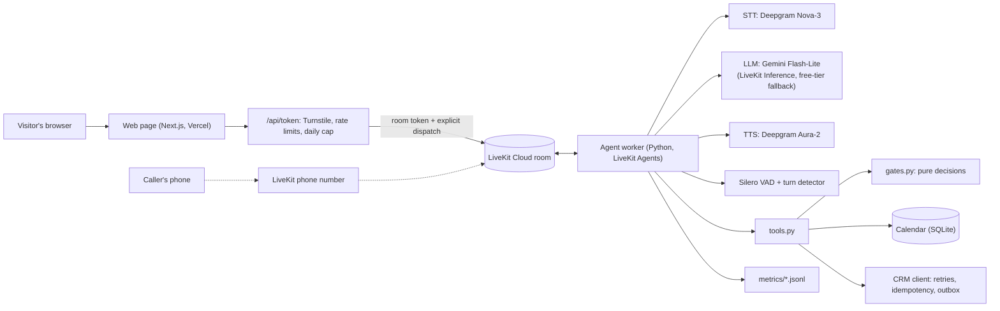

# Riley: an AI phone agent for HVAC service calls

A production-style AI phone agent built on an open-source real-time pipeline (LiveKit Agents),
for a fictional HVAC company. Call it, and it qualifies you, handles safety situations, and books
a service appointment.

Every piece of the real-time path is in this repo: speech-to-text, the LLM, text-to-speech, turn
detection, interruptions, tools, a tested decision layer, latency measurement and evaluations.

## Try it

**[Talk to Riley](https://riley-kestrel-comfort.vercel.app)** from any browser, no phone needed.
Kestrel Comfort is a fictional business: use a made-up name, a 555 number and a Phoenix ZIP such
as 85016. Calls are capped (a few per visitor per hour, four a day, one at a time), since the
demo runs on free tiers.

## Demo

Video: coming soon.

## What it does

Riley answers an inbound call with a recording disclosure. She works out why the caller is
calling and checks every turn for a safety hazard. She collects a name, callback number, ZIP
and the problem, then offers up to two open windows from the calendar. She reads the number and
window back before booking, and sends the lead to the CRM. Every call ends in exactly one
outcome, decided by code:

| Outcome | When |
| --- | --- |
| `booked` | In the service area, a service we offer, details complete, window confirmed |
| `safety_redirect` | Gas smell, CO alarm, burning smell, sparks or smoke: the exact safety script, then hang up |
| `out_of_area` | The ZIP isn't served |
| `not_offered` | A service the business doesn't provide (say, a commercial rooftop unit) |
| `callback_requested` | The caller wants a person, has a billing question, or needs something Riley can't do |
| `incomplete` | The caller hung up, went silent, or wouldn't give the details needed |

## Architecture



Web calls are the main channel. The phone path (dotted) is next: a free LiveKit number and a
dispatch rule. The token endpoint keeps the LiveKit secret on the server and dispatches the agent by
name. The decision layer (`gates.py`, `state.py`, `calendar.py`, `crm_client.py`) imports
nothing from LiveKit, so it's tested without a network or a model.

## Latency (measured)

Measured on the deployed agent (LiveKit Cloud, us-east) by LiveKit's audio simulator: 3 calls,
25 caller turns, 2026-10-25. Each number is one the agent actually logged per turn
(nearest-rank percentiles, [`scripts/latency_report.py`](scripts/latency_report.py)).

| Stage | p50 | p90 |
| --- | ---: | ---: |
| End of utterance (caller stops → turn committed) | 457 ms | 1,004 ms |
| STT final transcript | 291 ms | 383 ms |
| LLM first token | 479 ms | 920 ms |
| TTS first audio | 131 ms | 149 ms |
| **Total response** (caller stops → first agent audio) | **1,409 ms** | **2,565 ms** |

The target is 900 ms p50 / 1,400 ms p90 for web, so this **doesn't meet it yet**. What
dominates and what's been tried:

- **End of utterance is the largest part.** The turn detector waits longer when it isn't sure the
  caller has finished. Riley shortens that wait from 2.5 s to 1 s while she's asking for a name,
  number or ZIP, and lengthens the minimum for digits, so a pause between number groups doesn't
  cut the caller off.
- **Tool turns need two LLM round trips** (call the tool, then reply). Riley says a short "Got
  it." from inside the tool while the reply is written, so the caller hears something sooner.
- **The model was chosen by measurement.** Six models were benchmarked on LiveKit Inference; the
  Gemini free tier measured 11 to 28 s to first token from India at the start, so it isn't the
  primary. Preemptive generation is on.
- Dev's own browser calls in M2 measured 1,231 / 2,635 ms (6 calls, 17 turns), and he judged
  them responsive. Phone numbers come with M6.

The full log of measurements and trade-offs is in [`docs/decisions.md`](docs/decisions.md).

## The decision layer

**The LLM extracts, code decides, the LLM speaks the decision.** Riley never decides whether a
ZIP is served, a service is offered, a call is urgent or an appointment can be booked. She calls a
tool with what the caller said; the tool normalizes it, writes it to `CallState`, and runs pure
Python gates that return a decision plus what to say next.

A real turn (text-mode debugger):

```text
Caller: my AC stopped cooling completely, and my mom who's 80 lives with me
  -> record_issue(category="ac_repair", no_cooling_or_heat=true,
                  vulnerable_occupant="age_65_plus",
                  vulnerable_occupant_words="my mom who's 80 lives with me")
  <- {decision: MISSING, next_step: "ask:first_name",
      say: "Let them know you'll treat this as a priority visit. Ask for their first name."}
Riley:  Got it. I'm sorry to hear that. I've noted that this is a priority... May I have your
        first name?
```

Every gate is a pure function of `(CallState, BusinessConfig)`, table-tested without an LLM:

```python
def readiness_gate(state: CallState, cfg: BusinessConfig) -> GateResult:
    """READY_TO_BOOK only if eligible and complete. Booking refuses to run without it."""
    safety = safety_gate(state, cfg)
    if safety.decision is Decision.SAFETY_REDIRECT:
        return GateResult(Decision.NOT_BOOKABLE, safety.reason, safety.say, safety.next_step)
    if state.zip_code is not None and state.zip_code not in cfg.zip_codes:
        ...  # out of area: never bookable, whatever the caller or the model says
```

Where the model wasn't reliable, the rule moved into code, each with a test:

- **Safety:** a gas smell, CO alarm, burning smell, sparks or smoke plays the exact safety script
  and hangs up. There's no LLM reply to reword it.
- **Ending calls:** a gate that ends the call hangs up after Riley's one reply, so there's no
  double goodbye and no open line.
- **Short answers:** the turn detector waits at most 1 s, not 2.5 s, while Riley collects a name,
  number or ZIP.
- **Speech:** numbers are spoken the way people say them ("six oh two, five five five..."), the
  caller is addressed by name at most once, and a spoken "Got it." covers the tool's round trip.
- **Evidence:** the model once filled an optional field with an invented "infant", making a call
  priority. Now it must pass the caller's own words, and code checks them against the
  transcript; an invented quote isn't there, so the claim is dropped. The same idea covers
  numbers and ZIPs (made of digits the caller said, in order) and names ("mom" from "my mom is
  here" isn't saved as the caller's name).
- **Choices:** with two windows on offer, a bare "mm-hmm" doesn't pick one; Riley asks which.

Code: [`gates.py`](src/agent/gates.py), [`intake.py`](src/agent/intake.py),
[`tools.py`](src/agent/tools.py), [`spoken.py`](src/agent/spoken.py). Decisions and the
measurements behind them: [`docs/decisions.md`](docs/decisions.md).

## Booking and CRM

Booking follows the same pattern: the model picks up what the caller wants, code decides whether
it may happen. A real booking from the text-mode debugger, against the local mock CRM set to fail
twice:

```text
Caller: the first one works
  -> choose_window(window_id="2026-10-23T12:00")
  <- {decision: READ_BACK, next_step: "confirm_booking", say: "Read back their callback number,
      602-555-0142, and the window, tomorrow, 12-2 pm, and ask if that's all right."}
Riley (as spoken): Okay. One sec, checking the schedule. Just to confirm, I have you down
        for a visit tomorrow between noon and two in the afternoon, and I'll reach you at
        six oh two, five five five, oh one four two. Does that sound right?
Caller: yes, that's right
  -> book_appointment()
  <- {decision: BOOKED, say: "Tell them they're booked for tomorrow, 12-2 pm, then ask if
      there's anything else."}
  .. CRM: 500, 500, 201 (same Idempotency-Key each time; one lead stored)
```

- **Read-back in code:** `book_appointment` refuses unless the details are complete and eligible,
  a window offered on this call is held, and the caller has spoken since a read-back of exactly
  that number and window. Booking in the same turn as the read-back, or after a corrected number,
  is refused. A model talked into "just book it" can't skip it.
- **No double bookings:** bookings live in SQLite, and "count, then insert" runs under a write lock,
  because each call is its own process. The key (call id + window) makes a retried booking find
  the first one.
- **Leads that aren't lost or sent twice:** each lead is written to a local outbox before any
  network call, then sent in the background with an `Idempotency-Key`. Server errors and timeouts
  are retried (4 attempts, capped exponential backoff, full jitter). Anything still failing stays
  in the outbox for `scripts/redeliver_outbox.py`. The caller never waits on the CRM.
- **No dead air:** a calendar call slower than a second gets "One sec, checking the schedule."
  If the calendar fails outright, Riley offers a callback instead.

The mock CRM ([`mock_crm/app.py`](mock_crm/app.py)) runs locally and can be told to fail
(`POST /control {"fail_next": 2}`). The deployed demo has no CRM to reach, so its leads wait in the
outbox. Code: [`calendar.py`](src/agent/calendar.py), [`crm_client.py`](src/agent/crm_client.py).

## Testing

Three layers, cheapest first. Every bug found in a call became a test before it was fixed.

| Layer | What it checks | Run |
| --- | --- | --- |
| **Unit** (475 tests, CI on every push) | Gates, intake logic, calendar and idempotency, CRM retries against a fake server, text normalization, the LLM fallback. No LLM, no network | `uv run pytest -m "not llm"` |
| **Behavior** (24 tests, local) | Real multi-turn conversations in text mode with LiveKit's test framework: the right tools with the right arguments, the resulting state, and judged replies | `uv run pytest -m llm tests/behavior` |
| **Simulations** (14 scenarios) | Whole calls played by LiveKit's simulated caller: 8 core flows plus a corrected number ([`core.yaml`](tests/scenarios/core.yaml)), price pressure and prompt injection ([`guardrails.yaml`](tests/scenarios/guardrails.yaml)), and pauses, barge-in and backchannels in audio ([`audio.yaml`](tests/scenarios/audio.yaml)) | `lk agent simulate text --scenarios tests/scenarios/core.yaml src/agent/main.py` |

A simulation passes only if the judge passes the conversation **and** the call ended in the
state the scenario expects (outcome, window, number, priority). Code checks the state, so a call
that sounds right but booked the wrong slot fails.

**Call-quality grading** ([`qa/grade_call.py`](qa/grade_call.py)): deterministic checks first,
then an LLM rubric (accuracy, clarity, empathy, efficiency), each finding rated critical, major
or minor. The checks are: disclosure given, no booking without an answered read-back, nothing
booked after a closing gate, the exact safety script, and no price except the diagnostic fee.
Exit code 1 on any critical finding.

```text
lk agent simulate export <run-id> > run.json
uv run python -m qa.grade_call run.json --out qa/reports/run.md
```

The web page has its own tests (`cd web && pnpm test`), including the token endpoint's
admission rules.

## Running on $0

Everything runs on free tiers: LiveKit Cloud's Build plan (agent hosting, 1,000 session minutes
and $2.50 of model credit a month), Deepgram's signup credit, Google AI Studio's free tier,
Vercel Hobby, Cloudflare Turnstile and Upstash Redis. Because visitors spend the same quotas,
the page checks for a bot and limits calls per visitor and per day. Riley's LLM runs on the
LiveKit credit; when it runs out mid-month, a fallback to the Gemini free tier keeps calls
going, more slowly.

## Retell vs a custom pipeline

Coming soon: [`docs/retell-vs-custom.md`](docs/retell-vs-custom.md), from shipping production
agents on Retell AI.

## Run it yourself

You need Python 3.13 with [uv](https://docs.astral.sh/uv/), the
[LiveKit CLI](https://docs.livekit.io/home/cli/), a free LiveKit Cloud project, a Deepgram key
and a Google AI Studio key.

```bash
git clone https://github.com/waghdev/riley-hvac-voice-agent && cd riley-hvac-voice-agent
cp .env.example .env            # fill in the keys; `lk app env -w -d .env` writes LiveKit's
uv sync
uv run pytest -m "not llm"      # the unit suite: no keys needed
uv run python -m agent.main console   # talk to Riley through your mic and speakers
uv run python -m agent.main dev       # or join rooms on LiveKit Cloud (Agent Console)
```

The local mock CRM: `uv run uvicorn mock_crm.app:from_env --factory --port 8080` (set
`MOCK_CRM_URL`). The web page: see [`web/README.md`](web/README.md). Deploying the agent:
`lk agent deploy`.

## Built by

Dev Wagh, Co-Founder & CTO at Scaile AI. Built with Claude Code.

## Credits

- Keyboard typing sounds (Riley's "thinking" sound): "keyboard typing" by Anton,
  https://freesound.org/s/137/, licensed CC BY 4.0. Bundled with LiveKit Agents.
- Office ambience: bundled with LiveKit Agents.

## License

MIT, see [LICENSE](LICENSE). The web page starts from LiveKit's agent-starter-react (MIT,
[`web/LICENSE`](web/LICENSE)); its orb animation has its own license, noted in
[`web/README.md`](web/README.md).
